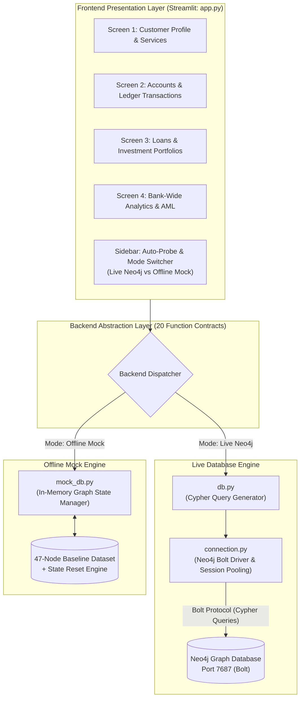
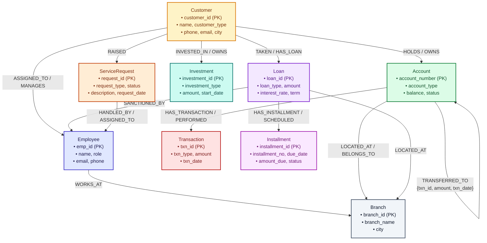

# 🏦 Smart Banking System with Neo4j Graph Database & Streamlit

[](https://www.python.org/)
[](https://neo4j.com/)
[](https://streamlit.io/)
[-success.svg)]()
[]()

> A production-grade, graph-native retail and corporate banking management platform powered by **Neo4j Graph Database** and **Streamlit**. Delivers relationship intelligence, real-time multi-hop money laundering (AML) fund tracing, customer 360 analytics, loan lifecycle management, and atomic ledger processing.

---

## 📑 Table of Contents

1. [Executive Summary](#1-executive-summary)
2. [Architecture & System Design](#2-architecture--system-design)
   - [System Data Flow Architecture](#system-data-flow-architecture)
   - [Dual-Backend Parity Architecture](#dual-backend-parity-architecture)
3. [Graph Schema & 47-Node Dataset](#3-graph-schema--47-node-dataset)
   - [Dataset Entity Breakdown](#dataset-entity-breakdown)
   - [12 Graph Relationship Types](#12-graph-relationship-types)
   - [Schema Diagram (Mermaid)](#graph-schema-diagram)
   - [Integrity Constraints](#schema-unique-constraints)
4. ["Why Neo4j?" — Graph Database Advantages in Banking](#4-why-neo4j--graph-database-advantages-in-banking)
   - [Multi-Hop Transaction Tracing & Anti-Money Laundering (AML)](#1-multi-hop-transaction-tracing--anti-money-laundering-aml)
   - [Customer 360 & Relationship Intelligence](#2-customer-360--relationship-intelligence)
   - [Real-Time Fraud Ring & Circular Movement Detection](#3-real-time-fraud-ring--circular-movement-detection)
   - [Schema Agility in Evolving Financial Products](#4-schema-agility--evolving-financial-products)
5. [User Interface Walkthrough (4 Screens)](#5-user-interface-walkthrough-4-screens)
   - [Screen 1: Customer Profile, Contact Updates & Service Requests](#screen-1-customer-profile-contact-updates--service-requests)
   - [Screen 2: Accounts Overview, Deposits, Withdrawals & Transfers](#screen-2-accounts-overview-deposits-withdrawals--atomic-transfers)
   - [Screen 3: Loan Portfolio, Repayment Schedules & Investments](#screen-3-loan-portfolio-repayment-schedules--investments)
   - [Screen 4: Bank-Wide Analytics & Graph Intelligence](#screen-4-bank-wide-analytics--graph-intelligence)
6. [Setup & Execution Guide](#6-setup--execution-guide)
   - [Prerequisites](#prerequisites)
   - [Step 1: Clone & Environment Setup](#step-1-clone--environment-setup)
   - [Step 2: Environment Configuration](#step-2-environment-configuration)
   - [Step 3: Load Graph Dataset (Optional Live Mode)](#step-3-load-graph-dataset-optional-live-mode)
   - [Step 4: Launch Streamlit Application](#step-4-launch-streamlit-application)
   - [Step 5: Execute Automated Test Suite](#step-5-execute-automated-test-suite)
7. [Testing & Verification Summary](#7-testing--verification-summary)
8. [File Structure & Code Layout](#8-file-structure--code-layout)

---

## 1. Executive Summary

Traditional relational database management systems (RDBMS) struggle with highly interconnected financial networks. Performing multi-table joins to assemble a 360-degree customer profile or executing recursive SQL queries for Anti-Money Laundering (AML) money trail investigations introduces exponential latency degradation ($O(k^d)$ join explosions), table locking, and rigid schema constraints.

The **Smart Banking System** solves these challenges by combining:
- **Neo4j Graph Database**: Uses index-free adjacency to traverse connections (accounts, loans, investments, transfers, employees, branches) in $O(1)$ constant time per relationship hop, regardless of database size.
- **Streamlit**: Provides a modern, responsive financial dashboard with real-time reactive updates, interactive data visualization, and comprehensive banking workflows.
- **Dual-Backend Architecture (Live Neo4j vs. Offline Mock)**:
  - **Live Neo4j Mode (`db.py`)**: Connects to Neo4j 5+ over the high-performance binary Bolt protocol (`bolt://`), executing parameter-safe Cypher queries with temporal string formatting (`toString(...)`), 3-part transaction `UNION`, and atomic multi-entity Cypher writes.
  - **Offline Mock Mode (`mock_db.py`)**: An in-memory Python graph simulation initialized with the exact 47-node seed dataset. It supports all 20 API contracts, atomic mutations (deposits, withdrawals, transfers, account lifecycles), and provides an instant `reset_mock_db()` function for repeatable testing and demonstrations with **zero external dependencies**.
  - **Auto-Detection & Graceful Fallback**: On startup, the application probes Neo4j on port 7687. If unreachable, it automatically defaults to Offline Mock Mode without crashing, notifying the user via the sidebar status indicator.

---

## 2. Architecture & System Design

### System Data Flow Architecture

The following diagram illustrates the end-to-end data flow between the user interface, backend abstraction layers, and persistence engines:



### Dual-Backend Parity Architecture

To ensure consistent behavior across development, testing, and production, `db.py` and `mock_db.py` implement identical interfaces:

1. **Exact 20 Function Signatures**: Both backends accept identical parameter names, types, and return identical data structures.
2. **Standardized Mutation Contracts**: All mutating operations (`add_customer`, `update_customer_contact`, `open_account`, `close_account`, `raise_service_request`, `process_transaction`, `transfer_money`) wrap execution in `try...except` and return structured status dictionaries:
   ```python
   {"success": True, "message": "Operation completed successfully", ...}
   ```
3. **Temporal Normalization**: All date properties (`txn_date`, `due_date`, `start_date`, `request_date`) are formatted as ISO-8601 strings (`YYYY-MM-DD`).
4. **Idempotency & Isolation**: Both backends handle constraints (e.g., duplicate customer IDs, overdraft rejections, zero-balance account closure enforcement) identically.

---

## 3. Graph Schema & 47-Node Dataset

The banking dataset contains **47 nodes** spanning **9 distinct entity labels** and interconnected by **12 relationship types**.

### Dataset Entity Breakdown

| Entity Label | Node Count | Identifiers | Key Attributes | Description |
|:---|:---:|:---|:---|:---|
| `Branch` | **3** | `BR01` - `BR03` | `branch_id`, `branch_name`, `city` | Physical branch locations (Anna Nagar, T Nagar, Koramangala). |
| `Employee` | **6** | `E01` - `E06` | `emp_id`, `name`, `role`, `email`, `phone` | Branch Managers, Relationship Managers, Loan Officers, CSEs. |
| `Customer` | **6** | `C01` - `C06` | `customer_id`, `name`, `customer_type`, `city`, `phone`, `email` | Retail & Corporate clients (Premium and Standard tiers). |
| `Account` | **8** | `AC1001` - `AC1008` | `account_number`, `account_type`, `balance`, `status` | Savings and Current deposit accounts. |
| `Transaction` | **8** | `T1` - `T8` | `txn_id`, `txn_type`, `amount`, `txn_date` | Cash deposits and ATM withdrawals. |
| `Loan` | **3** | `L01` - `L03` | `loan_id`, `loan_type`, `amount`, `interest_rate`, `term_months`, `status` | Home, Personal, and Vehicle credit facilities. |
| `Installment` | **6** | `INS01` - `INS06` | `installment_id`, `installment_no`, `due_date`, `amount_due`, `status` | Monthly repayment schedule items (`Paid` or `Pending`). |
| `Investment` | **4** | `I01` - `I04` | `investment_id`, `investment_type`, `amount`, `start_date` | Mutual Funds, Fixed Deposits, Wealth Management, Recurring Deposits. |
| `ServiceRequest` | **3** | `SR01` - `SR03` | `request_id`, `request_type`, `description`, `status`, `request_date` | Support tickets handled by Customer Service Executives. |
| **Total Nodes** | **47** | | | **Complete Baseline Graph Dataset** |

### 12 Graph Relationship Types

1. `WORKS_AT`: Directs `(Employee) -> (Branch)` indicating employee branch assignment.
2. `MANAGES` / `ASSIGNED_TO`: Directs `(Customer) -> (Employee)` linking customers to their Relationship Managers.
3. `SERVES` / `LOCATED_AT`: Directs `(Account) -> (Branch)` associating accounts with their home branches.
4. `HOLDS` / `OWNS`: Directs `(Customer) -> (Account)` establishing account ownership.
5. `PERFORMED` / `HAS_TRANSACTION`: Directs `(Account) -> (Transaction)` recording non-transfer cash operations.
6. `TRANSFERRED_TO`: Directed edge between `(Account) -> (Account)` with relationship attributes `{txn_id, amount, txn_date}` enabling graph path analysis.
7. `DISBURSED` / `TAKEN` / `HAS_LOAN`: Directs `(Customer) -> (Loan)` establishing credit facility ownership.
8. `MANAGED_BY` / `SANCTIONED_BY`: Directs `(Loan) -> (Employee)` linking loans to the sanctioning Loan Officer.
9. `SCHEDULED` / `HAS_INSTALLMENT`: Directs `(Loan) -> (Installment)` detailing repayment schedules.
10. `INVESTED_IN` / `HAS_INVESTMENT`: Directs `(Customer) -> (Investment)` representing wealth portfolio holdings.
11. `RAISED`: Directs `(Customer) -> (ServiceRequest)` linking customers to service requests.
12. `HANDLED_BY` / `ASSIGNED_TO`: Directs `(ServiceRequest) -> (Employee)` assigning requests to Customer Service Executives.

### Graph Schema Diagram



### Schema Unique Constraints

The database enforces **9 unique constraints** in `load_data.cypher` to guarantee data integrity across all primary identifiers:

```cypher
CREATE CONSTRAINT IF NOT EXISTS FOR (b:Branch) REQUIRE b.branch_id IS UNIQUE;
CREATE CONSTRAINT IF NOT EXISTS FOR (e:Employee) REQUIRE e.emp_id IS UNIQUE;
CREATE CONSTRAINT IF NOT EXISTS FOR (c:Customer) REQUIRE c.customer_id IS UNIQUE;
CREATE CONSTRAINT IF NOT EXISTS FOR (a:Account) REQUIRE a.account_number IS UNIQUE;
CREATE CONSTRAINT IF NOT EXISTS FOR (t:Transaction) REQUIRE t.txn_id IS UNIQUE;
CREATE CONSTRAINT IF NOT EXISTS FOR (l:Loan) REQUIRE l.loan_id IS UNIQUE;
CREATE CONSTRAINT IF NOT EXISTS FOR (i:Installment) REQUIRE i.installment_id IS UNIQUE;
CREATE CONSTRAINT IF NOT EXISTS FOR (inv:Investment) REQUIRE inv.investment_id IS UNIQUE;
CREATE CONSTRAINT IF NOT EXISTS FOR (sr:ServiceRequest) REQUIRE sr.request_id IS UNIQUE;
```

---

## 4. "Why Neo4j?" — Graph Database Advantages in Banking

During project demonstrations, academic evaluations, and technical presentations, use the following talking points to explain why Neo4j is superior to relational databases for modern financial infrastructure:

```
┌────────────────────────────────────────────────────────────────────────────────────────┐
│                        RDBMS vs. NEO4J ARCHITECTURAL COMPARISON                        │
├─────────────────────────────────────┬──────────────────────────────────────────────────┤
│ Relational Database (RDBMS)         │ Neo4j Graph Database                             │
├─────────────────────────────────────┼──────────────────────────────────────────────────┤
│ Tables & Foreign Keys (JOIN-based)  │ Nodes, Relationships & Properties (Native Graph) │
│ Pointer calculations at runtime     │ Index-Free Adjacency (Direct memory pointers)    │
│ Multi-hop queries scale as O(k^d)   │ Multi-hop queries scale linearly as O(d)         │
│ Costly recursive SQL CTEs           │ Expressive, pattern-based Cypher syntax          │
│ Rigid DDL migrations & downtime     │ Dynamic schema evolution without table locks     │
└─────────────────────────────────────┴──────────────────────────────────────────────────┘
```

### 1. Multi-Hop Transaction Tracing & Anti-Money Laundering (AML)

- **The Relational Bottleneck**:
  In an RDBMS, discovering layered fund transfers across multiple accounts requires recursive Common Table Expressions (`WITH RECURSIVE`) or self-joins on a massive `transfers` table.
  ```sql
  -- Relational SQL: Expensive Recursive CTE
  WITH RECURSIVE MoneyTrail AS (
      SELECT from_acc, to_acc, 1 AS hops FROM transfers WHERE from_acc = 'AC1001'
      UNION ALL
      SELECT t.from_acc, t.to_acc, mt.hops + 1
      FROM transfers t
      INNER JOIN MoneyTrail mt ON t.from_acc = mt.to_acc
      WHERE mt.hops < 3
  )
  SELECT * FROM MoneyTrail;
  ```
  Every hop requires an index lookup over millions of rows. At higher depths ($d \ge 3$), relational engines experience exponential query degradation ($O(k^d)$), causing latency spikes from milliseconds to minutes, table locks, and memory exhaustion.

- **The Neo4j Solution**:
  Neo4j uses **index-free adjacency**. Each account node maintains physical memory pointers directly to its incoming and outgoing relationships. Traversing an edge does not search an index; it simply dereferences a pointer.
  ```cypher
  // Neo4j Cypher: Declarative, Sub-Millisecond Pointer Traversal
  MATCH p = (a:Account {account_number: $account_number})-[:TRANSFERRED_TO*1..3]->(target:Account)
  RETURN [n in nodes(p) | n.account_number] AS trail, length(p) AS hops
  ```
  Query execution time is proportional **only to the size of the subgraph traversed**, completely independent of the total volume of data stored in the database.

### 2. Customer 360 & Relationship Intelligence

- In traditional banking data warehouses, reconstructing a single customer's portfolio requires joining 8 or more normalized tables (`customers`, `accounts`, `loans`, `installments`, `investments`, `service_requests`, `branches`, `employees`).
- In Neo4j, a customer is the natural center of an ego-network. Retrieving accounts, active loans, sanctioned officers, scheduled installments, and investment portfolios occurs through a single localized subgraph pattern match:
  ```cypher
  MATCH (c:Customer {customer_id: $cid})
  OPTIONAL MATCH (c)-[:HOLDS]->(a:Account)-[:LOCATED_AT]->(b:Branch)
  OPTIONAL MATCH (c)-[:TAKEN]->(l:Loan)-[:SANCTIONED_BY]->(lo:Employee)
  OPTIONAL MATCH (c)-[:INVESTED_IN]->(i:Investment)
  RETURN c, collect(DISTINCT a), collect(DISTINCT l), collect(DISTINCT i)
  ```
  This query runs in a fraction of a millisecond without the overhead of relational foreign-key table scans.

### 3. Real-Time Fraud Ring & Circular Movement Detection

- Fraudsters frequently employ circular money routing ($A \to B \to C \to D \to A$) to obscure origins, wash funds, or inflate credit limits.
- In relational databases, cycle detection across arbitrary hop lengths requires complex procedural loops or expensive graph algorithms executed outside the database.
- In Neo4j, circular patterns are natively expressed and executed in real time:
  ```cypher
  // Instant circular fraud ring detection
  MATCH path = (a:Account)-[:TRANSFERRED_TO*3..6]->(a)
  RETURN [node in nodes(path) | node.account_number] AS fraud_ring, length(path) AS cycle_length
  ```

### 4. Schema Agility & Evolving Financial Products

- Modern financial institutions regularly introduce new financial instruments (cryptocurrency wallets, Buy-Now-Pay-Later micro-loans, ESG green investments, co-signers, and corporate guarantors).
- In an RDBMS, adding polymorphic relationships requires `ALTER TABLE` statements, foreign key restructurings, migration scripts, and sparse tables cluttered with `NULL` columns.
- In Neo4j's labeled property graph model, new node types, attributes, and relationships can be introduced dynamically without disrupting existing queries or requiring schema migrations.

---

## 5. User Interface Walkthrough (4 Screens)

The Streamlit application (`app.py`) provides an intuitive, high-performance banking interface organized into four specialized screens accessible via the sidebar navigation menu:

```
┌────────────────────────────────────────────────────────────────────────┐
│                        STREAMLIT NAVIGATION MENU                       │
├────────────────────────────────────────────────────────────────────────┤
│  1. Customer Profile & Services                                        │
│  2. Accounts & Transactions                                            │
│  3. Loans & Investments                                                │
│  4. Analytics & Graph Intelligence                                     │
└────────────────────────────────────────────────────────────────────────┘
```

---

### Screen 1: Customer Profile, Contact Updates & Service Requests

Designed for bank relationship managers and customer service agents to manage customer identities and support cases.

- **Customer Selector & Profile Banner**:
  - Global sidebar dropdown allows selecting any customer (`C01` to `C06` or newly added customers).
  - Displays full customer KYC information (Customer ID, Full Name, City, Phone Number, Email, Assigned Relationship Manager).
  - Visual classification pill: `Premium Client` (Gold badge) vs. `Standard Client` (Blue badge).
  - Real-time aggregated balance metric across all accounts owned by the client.
- **Contact Details Update Form**:
  - Allows immediate updates to the customer's phone number and email address (`update_customer_contact`).
  - Input validation guarantees that neither field is submitted blank.
- **Customer Registration Expander**:
  - Form to onboard new retail or corporate customers (`add_customer`).
  - Validates required fields and enforces uniqueness of `customer_id` (rejects duplicates).
  - Automatically appends newly created customers into the global customer selection pool.
- **Service Requests Desk**:
  - Displays customer support tickets (`get_service_requests`) including Request ID, Category, Description, Status Pill (`🟢 Resolved` or `🟡 Pending`), Request Date, and assigned CSE (`Karthik Suresh - E05`).
  - Submission form (`raise_service_request`) to raise new requests (Cheque Books, Debit Cards, Address Updates, etc.), generating unique IDs via `new_id('SR')` and assigning them to CSE `E05`.

---

### Screen 2: Accounts Overview, Deposits, Withdrawals & Atomic Transfers

A unified ledger and cash processing console for managing deposit accounts and fund movements.

- **Multi-Account Card Overview**:
  - Dynamically renders summary cards for all accounts owned by the active customer (`get_accounts`), displaying account numbers, account types (Savings / Current), current balances formatted in Indian Rupees (₹), and branch associations.
- **Account Selector & Ledger Inspection**:
  - Dropdown to select the active operational account.
  - Consolidated transaction history table (`get_transactions`) combining:
    - 🟢 Cash Deposits (`Transaction` nodes)
    - 🔴 Cash Withdrawals (`Transaction` nodes)
    - 📥 Inward Transfers (`TRANSFERRED_TO` relationships where target is active account)
    - 📤 Outward Transfers (`TRANSFERRED_TO` relationships where source is active account)
  - Displays Transaction ID, Date, Formatted Type, Amount, and Counterparty Account.
- **Cash Transaction Interface**:
  - Form to execute deposits or withdrawals (`process_transaction`).
  - Generates transaction ID via `new_id('T')`.
  - Automatic balance update and overdraft protection (withdrawals exceeding available balance are rejected).
- **Inter-Account Atomic Fund Transfer**:
  - Form to transfer money from the active account to any destination account (`transfer_money`).
  - Prevents transfers to the same account and validates that destination accounts exist.
  - Updates both source and destination account balances atomically and creates a `TRANSFERRED_TO` edge with ID `new_id('TR')`.
- **Account Lifecycle Management**:
  - **Open Account**: Create a new Savings or Current account for the customer linked to any branch (`open_account`).
  - **Close Account (Strict Zero-Balance Rule)**: Terminates an account node only if its balance is **exactly ₹0.00** (`close_account`). Accounts with non-zero balances are rejected with explanatory warnings.

---

### Screen 3: Loan Portfolio, Repayment Schedules & Investments

Provides complete visibility into credit facilities, installment payment schedules, and wealth management portfolios.

- **Credit & Loan Facilities**:
  - Cards displaying loan facilities held by the customer (`get_loans`): Loan ID, Sanctioned Amount, Loan Type (Home Loan, Personal Loan, Car Loan), Interest Rate (%), Repayment Term (months), Sanctioning Loan Officer (`Divya Rao - E04`), and Branch.
- **Repayment Schedule Inspector**:
  - Select any loan facility to inspect its monthly repayment schedule (`get_repayment_schedule`).
  - Formatted schedule table showing Installment Number, Due Date, Due Amount, and status badges (`🟢 Paid`, `🟡 Pending`).
- **Wealth Management & Investment Portfolios**:
  - Summary metric showing total portfolio value across all investments (`get_investments`).
  - Tabular breakdown of investment holdings: Investment ID, Product Category (Mutual Funds, Fixed Deposits, Wealth Management, Recurring Deposits), Principal Amount, and Start Date.
  - Interactive asset allocation bar chart displaying investment exposure by category.

---

### Screen 4: Bank-Wide Analytics & Graph Intelligence

A comprehensive executive intelligence dashboard leveraging graph traversals and aggregate metrics.

- **Branch Account Distribution**:
  - Interactive bar chart and summary table (`get_branch_account_counts`) showing account density across branches (Anna Nagar: 3, T Nagar: 3, Koramangala: 2).
- **Customer Wealth Leaderboard**:
  - Interactive slider (1 to 10) to display the top depositors by aggregate balance (`get_top_customers_by_balance`).
  - Shows customer rank, ID, full name, and total balance.
- **AML High-Value Transfer Audit Monitor**:
  - Real-time audit tool filtering transfers that meet or exceed a configurable threshold (`get_large_transfers`).
  - Flags high-value transfers (e.g. ₹40,000 from AC1004 to AC1002, ₹25,000 from AC1002 to AC1007) with counterparty details and execution dates.
- **Multi-Hop Fund Flow & Money Trail Tracer**:
  - Visual graph path analyzer tracing the propagation of funds originating from any account across up to 3 hops (`get_money_trail`).
  - Executes variable-length Cypher traversal: `[:TRANSFERRED_TO*1..3]`.
  - Renders visual HTML breadcrumb paths:
    ```
    Path #1: [AC1001] ➔ [AC1003] (1 hop)
    Path #2: [AC1001] ➔ [AC1003] ➔ [AC1005] (2 hops)
    Path #3: [AC1001] ➔ [AC1003] ➔ [AC1005] ➔ [AC1006] (3 hops)
    ```

---

## 6. Setup & Execution Guide

### Prerequisites

- **Python**: Version 3.10, 3.11, or 3.12 installed.
- **Operating System**: Windows, macOS, or Linux.
- **Neo4j** *(Optional)*: Neo4j Desktop, Neo4j Community Server 5+, or Neo4j AuraDB.
  *(Note: The system is 100% functional in Offline Mock Mode without installing Neo4j).*

---

### Step 1: Clone & Environment Setup

```bash
# 1. Clone the project repository
git clone <repository-url>
cd dbms_da-3-project

# 2. Create a virtual environment
python -m venv .venv

# 3. Activate the virtual environment
# On Windows (PowerShell):
.venv\Scripts\Activate.ps1
# On Windows (Command Prompt):
.venv\Scripts\activate.bat
# On macOS / Linux:
source .venv/bin/activate

# 4. Install project dependencies
pip install -r requirements.txt
```

---

### Step 2: Environment Configuration

Copy the example environment configuration file to create `.env`:

```bash
# On Windows (PowerShell / CMD):
copy .env.example .env

# On macOS / Linux:
cp .env.example .env
```

Review or edit `.env` with your Neo4j credentials:

```env
NEO4J_URI=bolt://localhost:7687
NEO4J_USER=neo4j
NEO4J_PASSWORD=password
```

*(If you are running in offline mode without Neo4j, you can keep the defaults. The application will detect that port 7687 is unreachable and automatically start in Offline Mock Mode).*

---

### Step 3: Load Graph Dataset (Optional Live Mode)

If using a live Neo4j instance, initialize the database with the 47-node dataset and constraints:

- **Option A (via `cypher-shell`)**:
  ```bash
  cypher-shell -u neo4j -p password -f load_data.cypher
  ```
- **Option B (via Neo4j Browser UI)**:
  1. Open Neo4j Browser (`http://localhost:7474`).
  2. Copy and paste the contents of `load_data.cypher` into the query input editor.
  3. Execute the script to create all 9 constraints, 47 nodes, and relationship edges.

---

### Step 4: Launch Streamlit Application

Start the web application:

```bash
streamlit run app.py
```

The application will start and open automatically in your browser at `http://localhost:8501`. Use the sidebar to toggle between **Live Neo4j** and **Offline Mock** modes.

---

### Step 5: Execute Automated Test Suite

Run the comprehensive test suite to verify the 47-node dataset counts, all 20 API contracts, and edge cases:

```bash
# Standalone execution:
python test_suite.py

# Or via pytest:
pytest test_suite.py -v
```

---

## 7. Testing & Verification Summary

The project is verified against Section 8 benchmark test specifications, covering data integrity, query correctness, and error handling:

| Category | Target Contract / Scope | Assertion / Verification Criteria | Status |
|:---|:---|:---|:---:|
| **Dataset Counts** | 47 Nodes & 9 Labels | 3 Branches, 6 Employees, 6 Customers, 8 Accounts, 8 Transactions, 3 Loans, 6 Installments, 4 Investments, 3 Service Requests. | ✅ Pass |
| **Customer Read** | `get_customer('C01')` | Matches 'Samridhi Sharma', Type: 'Premium', RM: 'Priya Menon'. | ✅ Pass |
| **Accounts Read** | `get_accounts('C01')` | Exactly 2 accounts: AC1001 (₹85,000) and AC1002 (₹150,000). | ✅ Pass |
| **Balance Aggregation** | `get_total_balance('C01')` | Exactly ₹235,000.00 across AC1001 and AC1002. | ✅ Pass |
| **Ledger History** | `get_transactions('AC1001')` | Exactly 4 rows: Deposit (₹20k), Withdrawal (₹5k), Transfer Out (₹8k to AC1003), Transfer In (₹2k from AC1006). | ✅ Pass |
| **Credit Facility** | `get_loans('C01')` | Loan L01 (Home Loan, ₹2,500,000), Officer: Divya Rao, Branch: Anna Nagar. | ✅ Pass |
| **Repayment Schedule**| `get_repayment_schedule('L01')` | Exactly 3 installments (Installments 1 and 2 Paid, Installment 3 Pending). | ✅ Pass |
| **Investments** | `get_investments('C01')` | Exactly 2 items: I01 Mutual Fund (₹100k) and I03 Wealth Management (₹300k). | ✅ Pass |
| **Service Requests** | `get_service_requests('C01')`| Request SR03 ('Cheque Book', Status: 'Resolved', Handled by: 'Karthik Suresh'). | ✅ Pass |
| **Branch Distribution**| `get_branch_account_counts()` | Anna Nagar: 3 accounts, T Nagar: 3 accounts, Koramangala: 2 accounts. | ✅ Pass |
| **Wealth Leaderboard**| `get_top_customers_by_balance(3)`| Rank 1: C01 (₹235k), Rank 2: C03 (₹200k), Rank 3: C06 (₹95k). | ✅ Pass |
| **AML Transfers** | `get_large_transfers(20000)` | Matches TR6 (₹40k from AC1004 to AC1002) and TR4 (₹25k from AC1002 to AC1007). | ✅ Pass |
| **Money Trail (AML)** | `get_money_trail('AC1001')` | Exactly 3 directed paths: AC1001➔AC1003, AC1001➔AC1003➔AC1005, AC1001➔AC1003➔AC1005➔AC1006. | ✅ Pass |
| **Mutation: Deposit** | `process_transaction(...)` | Deposit ₹5,000 to AC1003 updates balance from ₹42,000 to ₹47,000. | ✅ Pass |
| **Mutation: Overdraft**| `process_transaction(...)` | Withdrawal of ₹99,999,999 from AC1003 rejected (`success: False`). | ✅ Pass |
| **Mutation: Transfer** | `transfer_money(...)` | Transfer ₹5,000 from AC1001 to AC1003 succeeds and updates both balances. | ✅ Pass |
| **Mutation: Uniqueness**| `add_customer('C01', ...)` | Attempting to create duplicate customer `C01` is rejected (`success: False`). | ✅ Pass |
| **Mutation: Closure** | `close_account('AC1008')` | Account AC1008 with balance ₹30,000 rejected for closure (`success: False`). | ✅ Pass |
| **Mutation: Lifecycle**| `open_account` & `close_account`| Open zero-balance account AC1009 and close AC1009 both succeed (`success: True`). | ✅ Pass |

---

## 8. File Structure & Code Layout

```
c:\dbms_da-3-project\
├── .env.example             # Template containing default Neo4j connection parameters
├── .gitignore               # Git ignore rules for environment files, cache, and venvs
├── requirements.txt         # Python package dependencies (neo4j, streamlit, dotenv, pandas)
├── load_data.cypher         # Neo4j initialization script (47 nodes, 9 constraints, 12 relations)
├── connection.py            # Neo4j Bolt driver helper, run_query session executor, new_id utility
├── db.py                    # Live Neo4j Cypher implementation of all 20 API contracts
├── mock_db.py               # Deterministic in-memory graph simulator of all 20 API contracts
├── app.py                   # Streamlit financial portal (4 screens + sidebar backend switcher)
├── test_suite.py            # Automated test suite verifying 47 nodes & 20 function contracts
└── README.md                # Complete system architecture and documentation
```

### Module Responsibilities

- **`connection.py`**: Manages Bolt driver lifecycles, session creation, parameter injection, and unique ID generation (`new_id`).
- **`db.py`**: Live Neo4j query layer. Translates high-level banking operations into optimized Cypher statements with temporal formatting, parameterized writes, and multi-hop graph traversals.
- **`mock_db.py`**: Offline in-memory simulation engine. Mirrors all 20 function contracts with identical state mutations, allowing full application usage and automated testing without external infrastructure.
- **`app.py`**: Streamlit frontend. Implements the 4 core banking screens, auto-detects database connectivity, applies custom CSS themes, and visualizes financial data and graph pathways.
- **`load_data.cypher`**: Canonical Cypher script for Neo4j 5+. Creates unique constraints and seeds the 47-node banking dataset.
- **`test_suite.py`**: Test harness executing automated assertions against the 20 database contracts, dataset counts, and business logic rules.

---

<div align="center">
  <b>Smart Banking System • Neo4j Graph Database & Streamlit Mini-Project</b><br>
  Built with ❤️ for modern graph data intelligence and real-time financial analytics.
</div>
